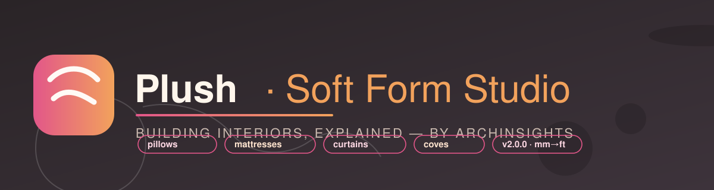

<div align="center">



# Plush — Soft Form Studio

**Soft Form Studio for SketchUp — pillows that sag like real cloth, mattresses that quilt,
walls that breathe.**

*Version 2.0.0 · by ArchInsights*

</div>

---

## What it does

Plush turns flat SketchUp faces into **real-world soft goods** — not just rounded graphics.
Every generated object is a dense, seam-conscious mesh you can render, texture and sell:

| Tool | What you get |
| --- | --- |
| 🛋 **Pillow Maker** | Seam piping, catenary sag inward mid-span, corner *dog-ear* pleats, seeded wrinkles, a flat apex cap instead of a pinched tip, and a *rest-on-surface* bottom that compresses against the ground |
| 🛏 **Mattress Maker** | Straight corners, side bulge, welt, exact bilinear **quilt cap** (grid / diamond / waves) matched per-edge to the top ring, optional **tufting craters**, plus Pillow-Top & Euro-Top layered caps |
| 🪑 **Cushion Maker** | Boxy seat cushions with welt piping and top stitching edge |
| 🌊 **Fabric Drape** | A falling cloth skirt over the face — flared hem, corners hanging slightly lower, hem wobble; the base face stays untouched |
| 🧱 **Curved Wall** | Organic bulge / S-curve / wave sweeps along faces or chained edges, with a soft wall wrinkle |
| 🕳 **Ceiling Curve** | Cove (concave), Crown (convex roll) and Scallop (undulating) fillets between ceiling and wall |
| **Curved Push/Pull** | Extrude curved surfaces the native Push/Pull cannot touch — per-normal or unified direction |
| ⬜ **Openings** | Rectangular or circular openings punched clean through panels, with soft corners and jambs |
| 🌀 **Loft Surface** | Ruled or smoothstep-eased lofts between two closed edge loops |
| ♻ **Pipe & Tube** | Solid or hollow tubes swept along any edge chain |
| ✏ **Soften Corners** | Automatic or manual-radius corner rounding, extrusion-aware |
| 🧰 **Utilities** | Soften/harden every edge in the selection, batch soften across many faces/groups |

## Real metric + imperial

A unit control lives in the header — **mm / cm / m / in / ft** — plus an **Auto** mode that
follows the active model. Every text field accepts explicit suffixes too: type `2in` inside
a metric workspace and it stays exactly 2 inches.

## The fabric engine (why it feels real)

- **Boundary refinement** — seams are subdivided per-span; cloth pulls **inward mid-span**
  using the catenary sag curve, so edges never stay unnaturally straight.
- **Piping / welt crest rings** with an independent width + height profile.
- **Ring-stack domes** driven by `ring_scale` — a quarter-ellipse shoulder easing onto a
  **flat plateau cap**, so tops stay plush instead of collapsing to an apex pinch.
- **Dog-ear pleats** gathered at the corners with gradient falloff.
- **Deterministic wrinkles** — seeded harmonic sum with an envelope that fades at the seam
  and apex; same seed = same pillow, every machine.
- **Rest-on-surface** compresses the lower dome like gravity would.

All math lives in `core_geometry.rb` (pure, testable, no entities) and `fabric_engine.rb`.

## Install

1. Download the newest `Plush-x.y.z.rbz` from the **packages/** folder of the product
   repository.
2. In SketchUp: **Extensions → Extension Manager → Install Extension**, then pick the file.
3. Open **Extensions → Plush - Soft Form Studio** — the toolbar uses the same 11 tools.

## Quick start

1. New tab: draw a bed slab face.
2. Click the **Pillow Maker** rail icon → hit **Pillow the Selection** (or pick face by face
   with the click tool — the pillow click tool is armed while the pillow tab is open).
3. Switch to the **Mattress Maker**, choose *Grid* quilting, tick **Tufting buttons**.
4. Dress it with **Fabric Drape**, and swap the fabric dot in seconds.

## Settings, licensing, updates

- Your panel state (tool, units, sliders, swatches, seeds) is saved automatically between
  sessions.
- Activation is offline-capable and **machine-bound**; previously activated customers from
  ArchInsights' Soft Edges tool stay activated with the same key.
- The studio checks a tiny JSON release feed in the background (configurable in the
  Updates tab) and can download + verify (SHA-256) the new package for you.

## Project layout

```
archinsights_plush.rb   ← Extension loader (registers with SketchUp)
main.rb                 ← dialog, operations, licensing, menus
core_geometry.rb        ← pure vector/spline/wrinkle math
fabric_engine.rb        ← pillow / mattress / cushion / drape ring engines
curves.rb               ← acute geometry: corners, walls, ceilings, lofts, pipes
updater.rb              ← release feed → download → SHA-256 → install
ui.html / ui.css / ui.js← the plush studio interface
icons/                  ← toolbar icons (PNG + @2x)
tools/                  ← icon + package build scripts
tests/                  ← headless test harness (run: ruby tests/run_all.rb)
```

## Requirements

- SketchUp 2019 or newer (HtmlDialog + add_faces_from_mesh APIs).
- Works on both Windows and macOS.

---

<div align="center">
<sub>Building interiors, explained. © 2026 ArchInsights — see <code>EULA.md</code>.</sub>
</div>
